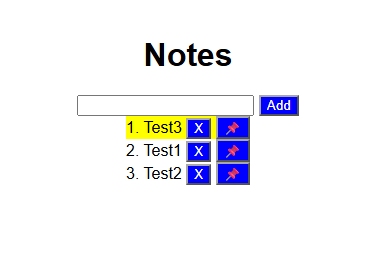

# Notes App

This is my little Notes App.
I just wanted to try out some API stuff and stumbled upon Express, that's why this project exists! During the making of this I also stumbled across EJS via [this video](https://www.youtube.com/watch?v=SccSCuHhOw0) by Web Dev Simplified.



## Features

- Add notes
- Delete notes
- Pin notes

## Built with

- Node.js
- Express
- EJS

## How to run it

You need [Node.js](https://nodejs.org/) installed.

```
git clone https://github.com/PeterSchweitzer5/notes-app.git
cd notes-app
npm install
npm run devStart
```

Then open http://localhost:3000 in your browser.

## How it works

The server is made with Express and the page is made with EJS.

When you add a note, the form sends it to the server. The server saves it in a list and writes the list into `notes.json`. Then it sends it back to the main page, which shows the notes.

Deleting and pinning work the same way. Every note has its own id, so the server knows which one you clicked on.

When you pin a note, it gets moved to the top of the list and turns yellow.

## What I learned

I learned how APIs and routes work and what I can do with them. As said I also learned about EJS and how I can use it together with the backend.
